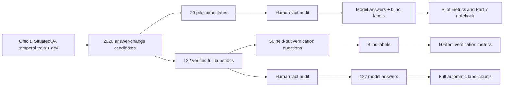

# SituatedQA pipeline plan

## Design and present state

The study uses the [SituatedQA temporal QA dataset](https://github.com/mikejqzhang/SituatedQA), with each selected question anchored to **2020**. Its 2020 answer is the proposed `Correct` answer; a distinct answer in an earlier dated record is a proposed `Outdated` answer. Other model responses are `Irrelevant` under the automatic rule. These are candidate facts until they pass human verification.

The official train and dev files are saved unchanged in `data/raw_benchmark/`, with hashes in [SITUATEDQA.md](../data/raw_benchmark/SITUATEDQA.md). The deterministic selector found 224 candidates after structural and wording filters. A permanent log removed 19 further wrong or unsuitable rows, leaving 205 candidates from which the selector drew 20 for the pilot and 200 for the original full list. The full fact audit verified 122 of those 200 and excluded 78. The instructor-approved amendment reported on 1 November 2026 uses those 122 verified IDs and a revised 50-item non-pilot verification list; see [the amendment record](protocol_amendment_record.md). The original frozen lists remain unchanged. Selection alone cannot detect every error in a question or answer. The earlier TempLAMA run is archived under `data/legacy_templama/` and `docs/legacy_templama/`.



## Phase 1 — Audit candidate facts

Start with `data/fact_audit.csv`. For each of the 20 rows, verify the meaning of the question, the proposed 2020 answer, and each earlier answer against dated evidence. An earlier answer must have **ceased to be valid by 2020**. Record at least one useful `evidence_url`, decision notes, and `status=verified` or `status=excluded`. Do not infer that the answer is correct merely because it is listed in SituatedQA. Do not look at automatic or model labels during the fact audit.

The completed `data/full_fact_audit.csv` covers all 200 original full-list rows, including the pilot. The 78 unsuitable rows are logged in `data/situatedqa_exclusions.csv`. Only the 122 verified rows appear in the amended list. The collector and evaluator refuse to run on any selected SituatedQA row without `status=verified` in the relevant audit sheet.

### Approved amendment after exclusions

The original replacement procedure could not restore 200 valid rows: only five eligible candidates remained outside the frozen selection. The approved procedure retains the 122 verified original rows in their original order. It preserves the 33 valid original verification IDs and selects 17 replacements from the other 69 verified non-pilot rows using seed 19. Run the recorded script if the amended lists need to be reproduced:

```powershell
.\.venv\Scripts\python.exe src/apply_protocol_amendment.py
```

The script verifies the original frozen hashes before writing new versioned lists. Keep the original CSVs unchanged. The corresponding blank response and annotation templates have been generated from the amended lists:

```powershell
.\.venv\Scripts\python.exe src/make_templates.py --questions data/full_questions_amended.csv --prefix full_amended
.\.venv\Scripts\python.exe src/make_templates.py --questions data/verification_questions_amended.csv --prefix verification_amended
```

**Gate:** Every ID selected for an experiment is `verified` with dated evidence. Pilot IDs remain a subset of full-study IDs; verification IDs do not overlap the pilot.

## Phase 2 — Complete the 20-item pilot

The old TempLAMA responses have been archived. The 20-item SituatedQA pilot is complete; keep its responses and labels separate from the held-out evaluation. The `.env` and virtual environment remain available.

```powershell
.\.venv\Scripts\python.exe -m pip install -r requirements.txt
.\.venv\Scripts\python.exe src/generate_responses.py
```

The collector writes `data/model_responses.csv` and metadata, saving after each answer. It resumes only when the existing model, URL, prompt, and question file match. Check that all 20 IDs have nonblank answers. Keep the API key only in `.env`.

Copy `data/templates/pilot_human_labels.csv` to `data/human_labels.csv` **once** and label every response independently using [annotation_protocol.md](annotation_protocol.md). The annotator should not see `auto_label`. Then run:

```powershell
.\.venv\Scripts\python.exe src/date_compare.py
.\.venv\Scripts\python.exe src/evaluate.py
```

The outputs are `data/auto_labels.csv`, `data/analysis_table.csv`, `results/metrics.json`, and `results/confusion_matrix.csv`. Report overall agreement, Cohen's kappa, and per-class precision, recall, F1, and support. Investigate every human/automatic disagreement, especially aliases, longer phrases, benchmark errors, and time ambiguity. Open `notebooks/pilot_run.ipynb` after evaluation for the Part 7 view: all 20 rows, metrics, confusion matrix, and examples for the classes that appear. Do not invent an example for an absent class.

**Gate:** Twenty verified facts, 20 model answers, 20 blind human labels, a joined analysis table, and a notebook that runs from saved files.

## Phase 3 — Collect and classify the full sample

The full audit and amendment are complete. Preserve the amended question CSVs, audit sheets, and model settings. Check the provider's current rate limit before setting the delay.

```powershell
.\.venv\Scripts\python.exe src/generate_responses.py --questions data/full_questions_amended.csv --output data/full_model_responses.csv --audit data/full_fact_audit.csv --delay 2.1
.\.venv\Scripts\python.exe src/date_compare_v2.py --questions data/full_questions_amended.csv --responses data/full_model_responses.csv --output data/full_auto_labels_v2.csv
.\.venv\Scripts\python.exe src/date_compare.py --questions data/full_questions_amended.csv --responses data/full_model_responses.csv --output data/full_auto_labels_exact.csv
```

Confirm one nonblank response and one label from each matcher per final full-sample ID. Summarize the two sets of automatic class counts separately, but do not call them accuracy estimates.

## Phase 4 — Evaluate the held-out verification subset

Copy `data/templates/verification_amended_human_labels.csv` to `data/verification_amended_human_labels.csv` **once**, then have an annotator label the 50 responses without seeing automatic labels. A second independent annotator for a subset is recommended; keep both original decisions and record reconciliation. Filter the 122-response file to the amended 50 IDs and evaluate:

```powershell
.\.venv\Scripts\python.exe src/filter_to_questions.py --questions data/verification_questions_amended.csv --input data/full_model_responses.csv --output data/verification_model_responses.csv
.\.venv\Scripts\python.exe src/evaluate.py --matcher year-token --questions data/verification_questions_amended.csv --responses data/verification_model_responses.csv --human-labels data/verification_amended_human_labels.csv --audit data/full_fact_audit.csv --analysis data/verification_analysis_v2.csv --results results/verification_v2
.\.venv\Scripts\python.exe src/evaluate.py --matcher exact --questions data/verification_questions_amended.csv --responses data/verification_model_responses.csv --human-labels data/verification_amended_human_labels.csv --audit data/full_fact_audit.csv --analysis data/verification_analysis_exact.csv --results results/verification_exact
```

The 50 labels were completed and preserved in `snapshots/verification_amended_human_labels_2026-11-01_120f5f83.csv`. The four frozen conditions, including the constant-label and token-overlap baselines, have been run with the prespecified bootstrap and paired tests:

```powershell
.\.venv\Scripts\python.exe src/compare_methods.py --human-labels snapshots/verification_amended_human_labels_2026-11-01_120f5f83.csv
```

The results are in `results/verification_primary_120f5f83/`; the dated interpretation and all 16 proposed-matcher errors are in `docs/verification_evaluation_2026-11-01.md` and `data/verification_error_analysis_2026-11-01.csv`. This estimates performance on the 50 annotated verification responses, not all 122. Keep pilot and post hoc sourced-reference results separate.

After the 50 human labels are finalized, the separately documented [post-collection reference expansion](exploratory_reference_expansion.md) may be run as an exploratory sensitivity analysis. Keep its outputs and claims separate from the frozen comparison.

## Phase 5 — Report and preserve the study

Document SituatedQA provenance, 2020 reference year, selection seeds and exclusions, final sample sizes, fact-audit evidence, model/provider, prompt, temperature, run dates, human protocol, matching rule, metrics, and disagreement categories. Keep the raw dataset, source hashes, question CSVs, audit sheets, response metadata, labels, scripts, notebook, and results. Exclude `.env`, keys, and `.venv` from submissions. An answer verified for 2020 is not necessarily current today.
