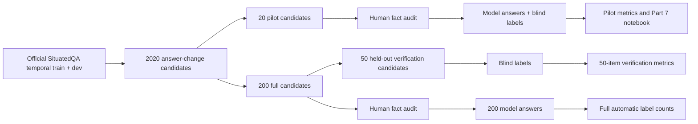

# SituatedQA pipeline plan

## Design and present state

The study uses the [SituatedQA temporal QA dataset](https://github.com/mikejqzhang/SituatedQA), with each selected question anchored to **2020**. Its 2020 answer is the proposed `Correct` answer; a distinct answer in an earlier dated record is a proposed `Outdated` answer. Other model responses are `Irrelevant` under the automatic rule. These are candidate facts until they pass human verification.

The official train and dev files are saved unchanged in `data/raw_benchmark/`, with hashes in [SITUATEDQA.md](../data/raw_benchmark/SITUATEDQA.md). The deterministic selector finds 224 candidates after structural and wording filters. A permanent log now removes 19 further wrong or unsuitable rows, leaving 205 candidates from which the selector draws 20 for the pilot and 200 for the full study; 50 of the non-pilot items are reserved for verification. The 20 pilot rows have been fact checked; the remaining 180 full-study rows are pending. Selection alone cannot detect every error in a question or answer. The earlier TempLAMA run is archived under `data/legacy_templama/` and `docs/legacy_templama/`.



## Phase 1 — Audit candidate facts

Start with `data/fact_audit.csv`. For each of the 20 rows, verify the meaning of the question, the proposed 2020 answer, and each earlier answer against dated evidence. An earlier answer must have **ceased to be valid by 2020**. Record at least one useful `evidence_url`, decision notes, and `status=verified` or `status=excluded`. Do not infer that the answer is correct merely because it is listed in SituatedQA. Do not look at automatic or model labels during the fact audit.

Apply the same procedure to `data/full_fact_audit.csv` before the 200-item collection. The full sheet includes the pilot rows. If a fact cannot be verified or the question has multiple valid interpretations, mark it `excluded` and append its ID, reason, and evidence to `data/situatedqa_exclusions.csv`. A name spelling or alias issue can be documented in notes, but a materially wrong answer should be excluded and replaced before the experiment. The collector and evaluator refuse to run on any selected SituatedQA row without `status=verified` in the relevant audit sheet.

### Replacing excluded candidates

Do this before collecting model answers for affected questions. The sampler shuffles the entire eligible pool once and removes excluded IDs **after** shuffling, so other selected IDs retain their order and the next unused candidate fills the gap. Pass both audit sheets if either contains exclusions:

```powershell
.\.venv\Scripts\python.exe src/select_sample.py --size 20 --output data/sample_questions.next.csv --exclude-audit data/fact_audit.csv --exclude-audit data/full_fact_audit.csv
.\.venv\Scripts\python.exe src/select_sample.py --size 200 --output data/full_questions.next.csv --exclude-audit data/fact_audit.csv --exclude-audit data/full_fact_audit.csv
.\.venv\Scripts\python.exe src/make_audit_sheet.py --questions data/sample_questions.next.csv --previous data/fact_audit.csv --output data/fact_audit.next.csv
.\.venv\Scripts\python.exe src/make_audit_sheet.py --questions data/full_questions.next.csv --previous data/full_fact_audit.csv --output data/full_fact_audit.next.csv
```

Review the `.next.csv` files, retain the old versions in an audit archive, then replace the canonical question and audit CSVs. Newly introduced rows are `pending` and need checking. If the eligible pool becomes too small for 200 verified facts, reduce the full-study size and report the final size; do not silently lower the audit standard. Regenerate the response and annotation templates and the 50-item verification subset after the final question files are frozen:

```powershell
.\.venv\Scripts\python.exe src/select_verification.py
.\.venv\Scripts\python.exe src/make_templates.py --questions data/sample_questions.csv --prefix pilot
.\.venv\Scripts\python.exe src/make_templates.py --questions data/full_questions.csv --prefix full
.\.venv\Scripts\python.exe src/make_templates.py --questions data/verification_questions.csv --prefix verification
```

**Gate:** Every ID selected for an experiment is `verified` with dated evidence. Pilot IDs remain a subset of full-study IDs; verification IDs do not overlap the pilot.

## Phase 2 — Complete the 20-item pilot

The old TempLAMA responses have been archived. No SituatedQA model responses have been collected. The `.env` and virtual environment remain available. After the final 20 facts are verified, run the fixed prompt against one model:

```powershell
.\.venv\Scripts\python.exe -m pip install -r requirements.txt
.\.venv\Scripts\python.exe src/generate_responses.py
```

The collector writes `data/model_responses.csv` and metadata, saving after each answer. It resumes only when the existing model, URL, prompt, and question file match. Check that all 20 IDs have nonblank answers. Keep the API key only in `.env`.

Copy `data/templates/pilot_human_labels.csv` to `data/human_labels.csv` **once** and label every response independently using [annotation_protocol.md](annotation_protocol.md). The annotator should not see `auto_label`. Then run:

```powershell
.\.venv\Scripts\python.exe src/date_compare.py
.\.venv\Scripts\python.exe src/evaluate.py
```

The outputs are `data/auto_labels.csv`, `data/analysis_table.csv`, `results/metrics.json`, and `results/confusion_matrix.csv`. Report overall agreement, Cohen's kappa, and per-class precision, recall, F1, and support. Investigate every human/automatic disagreement, especially aliases, longer phrases, benchmark errors, and time ambiguity. Open `notebooks/pilot_run.ipynb` after evaluation for the Part 7 view: all 20 rows, metrics, confusion matrix, and examples for the classes that appear. Do not invent an example for an absent class.

**Gate:** Twenty verified facts, 20 model answers, 20 blind human labels, a joined analysis table, and a notebook that runs from saved files.

## Phase 3 — Collect and classify the full sample

Finish and freeze the full audit first. Preserve a copy of the final question CSVs, audit sheets, and model settings. Check the provider's current rate limit before setting the delay.

```powershell
.\.venv\Scripts\python.exe src/generate_responses.py --questions data/full_questions.csv --output data/full_model_responses.csv --audit data/full_fact_audit.csv --delay 2.1
.\.venv\Scripts\python.exe src/date_compare.py --questions data/full_questions.csv --responses data/full_model_responses.csv --output data/full_auto_labels.csv
```

Confirm one nonblank response and one automatic label per final full-sample ID. Summarize the automatic class counts, but do not call them accuracy estimates.

## Phase 4 — Evaluate the held-out verification subset

Copy the verification human-label template **once**, then have an annotator label the 50 responses without seeing automatic labels. A second independent annotator for a subset is recommended; keep both original decisions and record reconciliation. Filter the 200-response file to the preselected 50 IDs and evaluate:

```powershell
.\.venv\Scripts\python.exe src/filter_to_questions.py --questions data/verification_questions.csv --input data/full_model_responses.csv --output data/verification_model_responses.csv
.\.venv\Scripts\python.exe src/evaluate.py --questions data/verification_questions.csv --responses data/verification_model_responses.csv --human-labels data/verification_human_labels.csv --audit data/full_fact_audit.csv --analysis data/verification_analysis.csv --results results/verification
```

Review every disagreement and report `results/verification/metrics.json`, the confusion matrix, class support, and representative error cases. This result estimates performance on the annotated verification subset, not all 200 rows. Keep pilot results separate if the matching rule was revised after the pilot.

## Phase 5 — Report and preserve the study

Document SituatedQA provenance, 2020 reference year, selection seeds and exclusions, final sample sizes, fact-audit evidence, model/provider, prompt, temperature, run dates, human protocol, matching rule, metrics, and disagreement categories. Keep the raw dataset, source hashes, question CSVs, audit sheets, response metadata, labels, scripts, notebook, and results. Exclude `.env`, keys, and `.venv` from submissions. An answer verified for 2020 is not necessarily current today.
