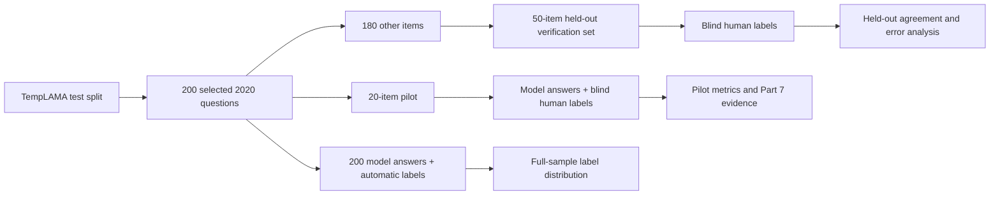

# Full pipeline plan: Outdated vs. Irrelevant

## Study definition

**Research question:** Can a simple date-aware matcher separate answers that are correct for a specified year from answers that were valid earlier and from other responses?

**Reference year:** 2020. Every selected question asks about 2020. In this project, `current_answer` means the benchmark's **2020** answer; it does not mean the answer today.

**Three labels:** `Correct` = the 2020 answer; `Outdated` = an earlier answer that had ceased to be valid by 2020; `Irrelevant` = another answer, refusal, or unresolved/mixed response. See [annotation_protocol.md](annotation_protocol.md) for human decisions and [matching_rules.md](matching_rules.md) for the automatic rule.

**Design:** Use the official TempLAMA test split, five change-sensitive relations, one fixed model and prompt, and deterministic samples. The 20-item pilot is contained in the 200-item full sample. The preselected 50-item verification subset is within the other 180 items, so it does not overlap the pilot. Sampling and source details are in the [README](../README.md) and [raw benchmark record](../data/raw_benchmark/README.md).



## Current project status

- The source dataset, selected 20/200/50 question files, scripts, templates, protocol, and pilot notebook are present.
- `data/model_responses.csv` has **20 nonblank answers for exactly the 20 pilot IDs**. Its metadata records `openai/gpt-oss-120b`, Groq, temperature 0, and the fixed prompt.
- Pilot human labels, pilot metrics, full-sample responses, and verification labels have not been created yet.

## Phase 0 — Freeze the design and check the facts

1. Keep copies of the existing question CSVs and record the source URL, source checksum, selection seed, relation list, model, prompt, temperature, and collection dates. The source checksum is already documented in `data/raw_benchmark/README.md`; the pilot request settings are in `data/model_responses.metadata.json`.
2. Audit the **20 pilot facts** against reliable dated evidence. Confirm that the 2020 answer was valid in 2020, every listed historical answer was previously valid, and each historical answer had ceased to hold by 2020. Record evidence links and any doubtful cases. Do this before inspecting the automatic labels.
3. Before collecting the 200-item run, apply the same audit to the 200 selected facts, especially the 50 verification items. Log any exclusion and its reason. A replacement requires a documented sample revision and, for any changed question, a newly collected model answer. Preserve the original files and revision history so exclusions cannot be mistaken for performance-based selection.
4. Freeze the three-class protocol and matching rule. Treat the 20-item pilot as a workflow check. If the rule changes after reviewing pilot errors, record the version and use the untouched 50-item subset for the main evaluation.

**Gate:** Every scored item has a defensible 2020 answer and genuinely older alternative, or a documented exclusion/replacement made before scoring.

## Phase 1 — Prepare the environment

Run these PowerShell commands from the project root. The virtual environment already exists; the first command creates it only if needed.

```powershell
if (-not (Test-Path .venv\Scripts\python.exe)) { py -3.11 -m venv .venv }
.\.venv\Scripts\python.exe -m pip install -r requirements.txt
```

Keep the API key in the project-root `.env`, following `.env.example`. Keep `.env` private. The response collector reads it automatically. Use the same model and prompt for pilot and full runs, and retain each run's `.metadata.json` file. Check the provider's current rate limit before choosing a delay; `2.1` seconds is the existing project's suggested setting.

**Gate:** The environment installs, the `.env` has a working key, and collection metadata identifies the model and prompt without exposing the key.

## Phase 2 — Finish the pilot (Part 7)

### 2.1 Collect or verify 20 model answers

The pilot response file is complete as of this plan. If collection was interrupted or a fact was replaced, rerun the collector; it resumes existing answers that match its metadata.

```powershell
.\.venv\Scripts\python.exe src\generate_responses.py
```

Check that the file contains one nonblank `model_answer` for every ID in `data/sample_questions.csv`. Retain `data/model_responses.metadata.json` with it.

### 2.2 Produce blind human labels

Create an editable copy of the template **once**, then fill its `human_label` column with exactly `Correct`, `Outdated`, or `Irrelevant` for all 20 rows. Keep useful notes and evidence URLs in the optional columns. Do not open `data/auto_labels.csv` or the automatic classifications while labeling. Do not rerun the copy command after annotation because it would replace your work.

```powershell
Copy-Item data\templates\pilot_human_labels.csv data\human_labels.csv
```

Use [annotation_protocol.md](annotation_protocol.md). Human labels can accept an unambiguous alias or short phrase; the automatic matcher uses a stricter rule. A blank or mixed answer needs a documented decision.

### 2.3 Run the matcher and evaluation

After the labels are complete:

```powershell
.\.venv\Scripts\python.exe src\date_compare.py
.\.venv\Scripts\python.exe src\evaluate.py
```

`date_compare.py` writes `data/auto_labels.csv`. `evaluate.py` joins all 20 question, response, and human-label IDs, then writes `data/analysis_table.csv`, `results/metrics.json`, and `results/confusion_matrix.csv`. It rejects missing or invalid human labels.

Review overall agreement, Cohen's kappa, and each class's precision, recall, F1, and support. Focus the write-up on `Outdated` and `Irrelevant`, while reporting `Correct` as well. The confusion matrix uses **human labels as rows** and **automatic labels as columns**. A class with no human examples has zero reported precision/recall/F1 under the script's convention; do not interpret that as measured failure on that class. Inspect every disagreement and code its cause, such as alias, extra text, benchmark issue, overlapping historical fact, model error, or another cause.

### 2.4 Prepare Part 7 evidence

Open `notebooks/pilot_run.ipynb` after the evaluation files exist. If Jupyter is absent, install it in `.venv` with `.\.venv\Scripts\python.exe -m pip install notebook`. Run all notebook cells and verify that it shows the 20 joined rows, metrics, confusion matrix, and one example for each class **that actually appears**. Include the notebook, the analysis table, protocol, matching rules, source citation, and a short paragraph on errors and limitations in the submission. An absent class should be stated plainly; do not invent an example or label.

**Gate:** Twenty auditable labels, a reproducible analysis table, computed metrics, and a notebook that runs from saved inputs.

## Phase 3 — Run the full 200-item study

1. Finish the 200-fact source audit and freeze the full and verification question IDs.
2. Collect all 200 responses with the same model and prompt. The collector saves each response and can resume an interrupted run. Confirm that its metadata matches the pilot setup. Check current provider limits and adjust `--delay` if necessary.

```powershell
.\.venv\Scripts\python.exe src\generate_responses.py --questions data/full_questions.csv --output data/full_model_responses.csv --delay 2.1
```

3. Apply the **frozen** automatic rule to all 200 answers.

```powershell
.\.venv\Scripts\python.exe src\date_compare.py --questions data/full_questions.csv --responses data/full_model_responses.csv --output data/full_auto_labels.csv
```

4. Summarize the automatic label counts by class and relation across the 200. Describe these as model/matcher outputs, not validated accuracy measurements.

**Gate:** Exactly 200 nonblank answers and 200 automatic labels, one per frozen full-sample ID, with run metadata saved.

## Phase 4 — Evaluate the held-out 50

1. Copy the prepared verification label template **once**. Have an annotator label all 50 response rows using the frozen protocol without viewing automatic labels. A second independent annotator on a subset is recommended; save both original decisions, reconcile disagreements, and report how many differed. Do not rerun the copy command after annotation.

```powershell
Copy-Item data\templates\verification_human_labels.csv data\verification_human_labels.csv
```

2. Extract the 50 responses from the full 200-response file and evaluate only those IDs.

```powershell
.\.venv\Scripts\python.exe src\filter_to_questions.py --questions data/verification_questions.csv --input data/full_model_responses.csv --output data/verification_model_responses.csv
.\.venv\Scripts\python.exe src\evaluate.py --questions data/verification_questions.csv --responses data/verification_model_responses.csv --human-labels data/verification_human_labels.csv --analysis data/verification_analysis.csv --results results/verification
```

3. Review `results/verification/metrics.json`, `results/verification/confusion_matrix.csv`, and each row in `data/verification_analysis.csv`. Categorize every human/automatic disagreement and show representative examples with the decision reason. Report the number of human examples in each class. Keep the 50-item verification result separate from the exploratory 20-item pilot result.

**Gate:** Fifty complete independent labels, a 50-row joined table, a confusion matrix, per-class metrics, and a documented disagreement audit.

## Phase 5 — Write up and package the study

Report the research question, TempLAMA provenance, 2020 reference year, exact sample sizes and relation mix, selection seeds, fact-audit/exclusion log, model/provider and settings, prompt, collection dates, human protocol, automatic matching rule, both result sets, and representative errors. State whether the matcher was changed after the pilot. Keep the raw benchmark, question files, response files, run metadata, labels, scripts, notebook, and outputs together for reproducibility. Exclude `.env`, API keys, and virtual-environment files from any submission or repository.

Interpret the metrics within their scope:

- Pilot agreement measures this fixed 20-item workflow and may be optimistic if it informed a rule change.
- Verification agreement estimates performance on the **annotated 50**, not all 200. The 200 automatic-label counts describe the full selected sample but have no human ground truth for the other 150 items.
- A TempLAMA 2020 answer is a benchmark reference, subject to source errors. It is not a claim about the present day.
- Exact normalized matching can call valid aliases or longer answers `Irrelevant`; report these disagreements rather than silently fixing them after seeing verification labels.
- One model, one prompt, five relations, and a selected benchmark subset limit generalization. Report class support with every precision/recall/F1 value, especially if a class is rare or absent.

## Immediate next action

Audit the 20 pilot facts, create `data/human_labels.csv` from the template, and label the 20 existing responses blind. Then run the two pilot commands in Phase 2.3. No new API call is needed for the existing pilot sample unless its audited questions change.
